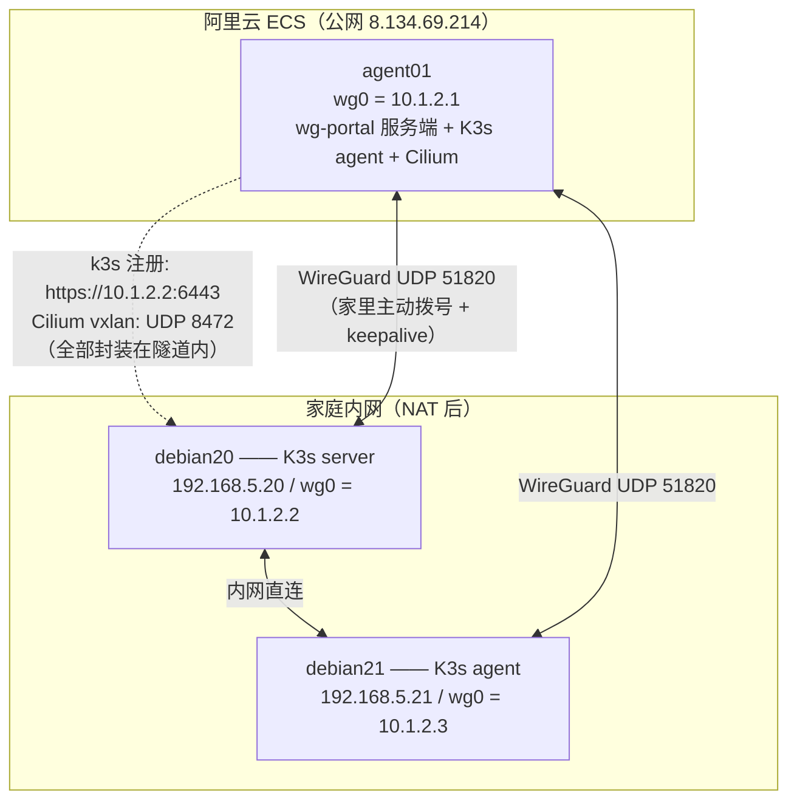

## 背景：一个「拧巴」的算力分布

我的情况大概是这样的：

- **家里**：两台 Debian 机器跑着一个 K3s 集群（`debian20` server + `debian21` agent），Cilium vxlan CNI，业务 Pod 都在这两台上——算力足、内网互通零成本，但**家庭宽带没有公网 IPv4**，NAT 出口天天变；
- **云上**：一台阿里云 ECS（下称 `agent01`），有固定公网 IP，上面已经用 [wg-portal](https://github.com/h44z/wg-portal) 跑着一套 WireGuard 服务端（`wg0=10.1.2.1`），与家里 master 之间有一条**常年活跃**的隧道。

于是需求自然浮现：**能不能让云上这台 ECS 以 K3s agent 身份加入家庭集群？** 这样它就能承担「公网入口节点」的角色——对外的 Ingress、需要固定公网 IP 的回调、爬虫类负载放云上，重活儿留在家里。

难点在于：K3s agent 注册 master 要走 6443，节点间 Cilium vxlan 要走 UDP 8472。家庭宽带无公网，总不能把 6443 映射出去裸奔吧？

**答案：这两条流量全部封装进已有的 WireGuard 隧道。** 云安全组一个新端口都不用开。

## 架构：三层封装，一条隧道

先上拓扑：



理解这套架构的钥匙是**三层封装**：

| 层 | 内容 | 承载 |
|----|------|------|
| L1 WireGuard | UDP 51820，唯一跨公网的流量 | 其余全部封装在内 |
| L2 控制面 | agent01 → `10.1.2.2:6443`（注册、心跳、watch） | 走 L1 |
| L2 数据面 | 节点间 Cilium vxlan（UDP 8472） | agent01↔家里走 L1；家里两台内网直连 |

公网端口账单非常干净：

| 端口 | 协议 | 是否需要暴露 |
|------|------|--------------|
| 51820 | UDP | ✅（wg-portal 本来就开着） |
| 6443 | TCP | ❌ 走隧道 |
| 8472 | UDP | ❌ 走隧道 |

有意思的是，「家庭无公网」在这里反而成了架构优势：所有入口天然收敛到云上一条 WG 隧道，master 想暴露都暴露不了。

> 对比一下 Kilo（自动建 WG 的 CNI）方案：master 的 6443 **必须**对公网放行。我否决了它——不想换 CNI 重建集群，更不想 6443 见公网。

## 实施五步

### 第 1 步：master 补证书 SAN（debian20）

agent 要通过 `https://10.1.2.2:6443` 注册，但 apiserver 证书 SAN 里只有内网 IP。不补，注册必报 `x509: certificate is valid for 192.168.5.20, not 10.1.2.2`。

```bash
# debian20：追加 tls-san
cat >> /etc/rancher/k3s/config.yaml <<'EOF'
tls-san:
  - 10.1.2.2
EOF

# 删 serving 证书，k3s 重启时自动重签
systemctl stop k3s
rm -f /var/lib/rancher/k3s/server/tls/serving-kube-apiserver.crt \
      /var/lib/rancher/k3s/server/tls/serving-kube-apiserver.key
systemctl start k3s

# 验证：SAN 里出现 10.1.2.2
openssl x509 -in /var/lib/rancher/k3s/server/tls/serving-kube-apiserver.crt \
  -noout -text | grep -A1 'Alternative' | tail -1
```

重启只中断 API 约 30~60 秒，业务 Pod 不受影响。验证时在 agent01 上 `curl -sk https://10.1.2.2:6443/healthz`，返回 401（禁匿名）即说明网络和 TLS 层全通。

### 第 2 步：debian21 也接入 WireGuard

这步**不能省**。Cilium `tunnel/vxlan` 模式是**全互联**——每个节点都要和其他所有节点直连 vxlan。debian21 不接 WG，它和 agent01 之间的 Pod 流量就是断的。

在 wg-portal 网页上给 debian21 建一个 peer（`10.1.2.3/32`），下载配置落地：

```bash
# debian21
apt install -y wireguard-tools   # 内核 6.1 自带 wireguard 模块
install -m 600 wg0.conf /etc/wireguard/wg0.conf
systemctl enable --now wg-quick@wg0   # 一定要 enable！手动拉起的接口重启就没了
```

> 排查时发现我家里两台的 `wg-quick@wg0` 都是手动拉起的、未设自启——**存量隐患**，重启即断链。本次一并修复。

### 第 3 步：扩 Extra AllowedIPs（本文最大的坑）★

**现象**：agent01 注册成功、三节点 Ready，但跨公网的 Pod 互 ping 100% 丢包。

**根因**：Cilium 从 agent01 发往家里 Pod 的 vxlan 封装包，**外层目的 IP 是对端 node-ip（`192.168.5.x`），不是 WG IP（`10.1.2.x`）**。而 WireGuard 出向是按 peer 的 AllowedIPs 做路由选择 + 过滤的——agent01 侧 peer 的 AllowedIPs 只有 `10.1.2.x/32`，目的为 `192.168.5.x` 的包**匹配不到任何 peer，直接被丢弃**。

我一开始想当然地加了静态路由——**没用**。静态路由只能决定「走 wg0 这个接口」，包进了 WG 层照样被 AllowedIPs 过滤掉。

**正解**：在 wg-portal 里给两个 peer 加 **Extra Allowed IPs**（等价于 GUI 操作：Peer 编辑 → Extra Allowed IPs 填 `192.168.5.20/32`）：

```bash
# agent01（wg-portal 数据在 sqlite，改前先备份）
sqlite3 /opt/wg-portal/data/sqlite.db "
UPDATE peers SET extra_allowed_ips_str='192.168.5.20/32' WHERE identifier='<debian20公钥>';
UPDATE peers SET extra_allowed_ips_str='192.168.5.21/32' WHERE identifier='<debian21公钥>';"
systemctl restart wg-portal
```

wg-portal 会同步内核 wg0 并自动维护策略路由（fwmark + 专属路由表），重启后自动恢复：

```bash
# agent01 验证
wg show wg0 | grep -A3 '^peer'
#   peer(debian20): allowed ips: 10.1.2.2/32, 192.168.5.20/32
#   peer(debian21): allowed ips: 10.1.2.3/32, 192.168.5.21/32

ping -c 2 192.168.5.20   # 0% loss, ~13ms
```

**一句话记住这个坑**：WireGuard 的 AllowedIPs 既是路由表也是防火墙，静态路由救不了它。

### 第 4 步：agent01 安装 K3s agent

两个关键点：`node-ip` 必须是 WG IP；版本与集群严格对齐。

```bash
# agent01
cat > /etc/rancher/k3s/config.yaml <<'EOF'
node-name: agent01
node-ip: 10.1.2.1        # ★ 必须是 WG IP，否则默认选阿里云 VPC 内网 172.18.x.x，跨公网不可达
EOF

curl -sfL https://rancher-mirror.rancher.cn/k3s/k3s-install.sh | \
  INSTALL_K3S_MIRROR=cn \
  INSTALL_K3S_VERSION=v1.33.11+k3s1 \
  K3S_URL=https://10.1.2.2:6443 \
  K3S_TOKEN=<node-token> \
  sh -s - agent
```

`K3S_URL` 指向 master 的 **WG IP**——这就是「零公网暴露」的落点。注意 agent 端 config 只放节点标识类字段，`flannel-backend` 之类 server 专用字段写了会 fatal。

### 第 5 步：验证矩阵

| # | 验证项 | 结果 |
|---|--------|------|
| 1 | `kubectl get nodes` | ✅ 3 节点 Ready，agent01 INTERNAL-IP=10.1.2.1 |
| 2 | Cilium DaemonSet | ✅ 3/3 Running（12 秒内自动覆盖新节点） |
| 3 | `cilium-health status` | ✅ 3/3 reachable |
| 4 | 跨公网 Pod 互 ping | ✅ 双向 0% loss，RTT ~13.5ms |
| 5 | 跨公网 wget 10MB | ✅ md5 一致，亚秒完成 |

## 踩坑实录：跨节点不通的分层排查

第 5 步的第一个测试 Pod 曾 100% 丢包（后来定位是AllowedIPs 之外**又一个**干扰源），排查路径值得单独记录——分层排查是这类问题的万能钥匙：

```text
L1 节点级 ping（agent01 ↔ 192.168.5.x）        → 通 ✅（传输层没问题）
L2 UDP 8472 探针（iptables 计数器 + /dev/udp） → 计数命中 ✅（WG 对 vxlan 无限制）
L3 cilium-health + PodCIDR 路由核对            → 3/3 reachable ✅
L4 cilium-dbg monitor --type drop              → ★ 抓到 "drop (Policy denied)"
L5 kubectl get networkpolicy -A                → default 命名空间有存量策略，ingress 全禁
```

结论：`default` 命名空间有条历史遗留的 NetworkPolicy（ingress 全员禁入），与新接的节点毫无关系。**测试换独立命名空间，全通。**

顺手记录一个 kubectl 的坑：`kubectl get networkpolicies.policy -A` 会解析到**已废弃的 API group**，静默返回空列表——核对策略务必用 `kubectl get networkpolicy`（不带 `.policy` 后缀）。这种「命令成功但结果骗人」的坑最坑人。

## MTU：算清楚链路，就不用调

三层封装后 MTU 自然缩水，链路是 `eth0 1500 → wg0 1420 → vxlan 有效 ≈1370`。

实测边界非常清晰：跨公网 Pod 间 ICMP，`ping -s 1342`（帧 1370）恰好通过，`ping -s 1360` 100% 丢。但 **TCP 完全正常**——PMTUD 自动适配，10MB 传输 md5 一致、亚秒完成。

**决策：不调全局 MTU。** 跨公网段 1370 是物理硬限制，全局下调只会拖累家里两台内网直连（1500）的吞吐，得不偿失。只需要记住：排障时看到大包 ping 丢、小包通，先想想是不是 MTU，别急着怀疑「网络不通」。

## 进阶：让云节点专做公网入口

节点加进来只是开始，还得管住调度——agent01 与家里互访的每个字节都穿公网隧道（RTT 13.5ms、MTU 1370），普通业务负载不该默认落上去：

```bash
# 打 taint：普通负载默认避开 agent01（系统组件自带容忍不受影响）
kubectl taint nodes agent01 egress=public:NoSchedule

# 语义标签：需要公网出口的负载显式选择
kubectl label nodes agent01  egress=public --overwrite
kubectl label nodes debian20 egress=home   --overwrite
kubectl label nodes debian21 egress=home   --overwrite
```

需要公网出口的负载这样声明：

```yaml
spec:
  nodeSelector:
    egress: public
  tolerations:
  - key: egress
    operator: Equal
    value: public
    effect: NoSchedule
```

至此形成完整的**「云端入口 + 内网算力」**格局：对外入口在云上（固定 IP、备案友好），重负载在家里（内网直连 0.27ms）。

### 入口层选型的一段弯路

公网 Ingress 我先后试了两代方案：

1. **Cilium 内置 Ingress Controller**：HTTP/HTTPS 工作良好，但任意 TCP 端口代理（用 `CiliumEnvoyConfig`）在 cilium 1.19.4 独立 envoy 模式下 **EDS 后端注入始终失败**，TCP 代理恒 RST。多轮排障（envoy admin 里 cluster 建不出、agent 报 `ADS must be configured`）后放弃。
2. **Envoy Gateway（Gateway API）**：HTTPRoute/TCPRoute 都是 K8s 标准 CRD，TCP 代理开箱即用。最终 80/443（HTTP/HTTPS）+ 11199（OpenVPN over TCP）全部由它接管，**OpenVPN 客户端真实连接验证通过**。

两条经验送给大家：

- 安装大 CRD 时 `kubectl apply --server-side`，否则可能撞上 `last-applied annotation Too long` 的 262144 字节限制；
- 入口端口暴露的终版方案是**直接把 envoy service 的 nodePort 设为 80/443/11199**（master 配了 `service-node-port-range=0-40000`），公网包直达 `KUBE-NODEPORTS` 链，**零 iptables**。过渡期试过 REDIRECT→NodePort 端口——在 KPR 混合模式下恒 refused，因为绕行包不再过 KUBE 链，这种「教科书上合法、组合起来失效」的坑，只有实测才能暴露。

## 效果与总结

最终形态：

- **3 节点混合集群**：家里 2 台（算力）+ 云上 1 台（公网入口/出口）
- **公网暴露面**：仅 WG UDP 51820 + 入口层 80/443/11199，6443 与 vxlan 全程隧道内
- **存量侵入**：master 只加了一行 `tls-san`，原业务零迁移
- **可回滚**：agent 端一键卸载脚本 + master 还原备份配置即可整体退回

三个最值得带走的坑：

1. **AllowedIPs 是路由表也是防火墙**——vxlan 外层目的用的是 node-ip，不在 peer 的 AllowedIPs 里就被静默丢弃，静态路由救不了；
2. **分层排查**（节点 ping → UDP 探针 → cilium-health → eBPF monitor → 策略对象）是 CNI 问题的万能钥匙，eBPF 时代丢包原因往往不在网络层；
3. **封装链路的 MTU 要实测边界**（1370），TCP 有 PMTUD 兜底，别为了 ICMP 大包全局下调 MTU。

这套「无公网家庭集群 + 云节点入口」的思路，同样适用于 Tailscale/Headscale 等任何 overlay 隧道——核心从来不是工具，而是**把跨公网流量收敛到一条加密隧道里**这个架构决策。
